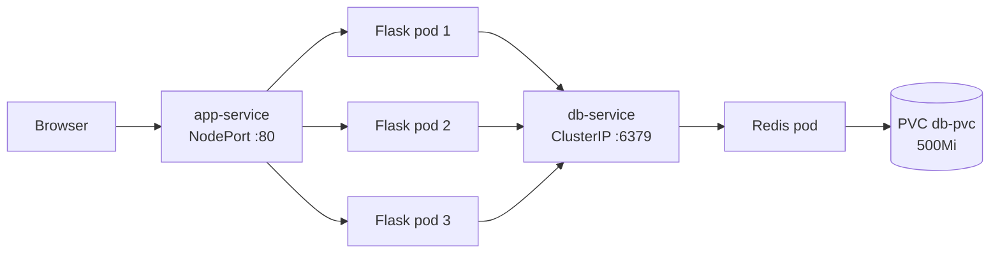

# Task Manager on Kubernetes

A small two-tier web app (Flask + Redis) built to practice the full DevOps loop: **Git → CI/CD (GitHub Actions) → Docker Hub → Kubernetes (Minikube)**.

The app itself is simple on purpose. The goal of the project is the pipeline and the Kubernetes deployment around it.

- **Docker image:** `mghzakariae/k8s_proj`
- **Current version:** `v1.0.1`
- **Stack:** Python 3.13, Flask, Redis, Docker, GitHub Actions, Kubernetes (Minikube)

---

## 1. What the app does

- A user logs in with a username (stored in a signed session cookie).
- The user can add tasks and see their own task list.
- Tasks are stored in Redis, in one list per user (`<username>:tasks`).

| Route | Method | Purpose |
|---|---|---|
| `/login` | GET, POST | Login form, creates the session |
| `/` | GET, POST | Show tasks / add a task |
| `/logout` | GET | End the session |

---

## 2. Architecture



**Why this design**

- **Flask and Redis are separate Deployments.** The web tier is stateless and can scale. Redis holds state, so it stays at one replica with its own storage.
- **All Flask replicas share one Redis**, reached by DNS name (`db-service`). A task added through one pod is visible through every pod.
- **All replicas share the same `SECRET_KEY`** (from a Kubernetes Secret). This is why a login session created by one pod is accepted by the others.
- **Redis runs with `--appendonly yes`** and `/data` mounted on a PVC, so data can survive a pod restart.

---

## 3. CI/CD pipeline

Defined in `.github/workflows/docker.yml`.

**Triggers:** push to `main` / `master`, and tags matching `v*.*.*`.

```
push / tag ──► test job (pytest) ──► docker job (build + push to Docker Hub)
```

1. **test**: installs dependencies and runs `pytest`.
2. **docker** (runs only if `test` passes): logs in to Docker Hub and builds and pushes the image.

**Image tags** are generated by `docker/metadata-action`:

| Tag | Meaning |
|---|---|
| `main` | Latest build of the main branch |
| `sha-<commit>` | Exact commit that produced the image |
| `v1.0.1` | Release version (from a Git tag) |
| `latest` | Latest build of the default branch |

Credentials (`DOCKERHUB_USERNAME`, `DOCKERHUB_TOKEN`) are stored as GitHub repository secrets.

**Release flow**

```bash
git commit -am "my change"
git push origin main
git tag v1.0.2
git push origin v1.0.2      # triggers the pipeline and publishes the v1.0.2 image
```

Then change the image tag in `k8s/deployment_app.yaml` and apply it.

---

## 4. Kubernetes resources

All manifests are in `k8s/`.

| File | Kind | Purpose |
|---|---|---|
| `app-config.yaml` | ConfigMap | `REDIS_HOST`, `REDIS_PORT`, `DEBUG` |
| `app-secrets.yaml` | Secret | `SECRET_KEY` (**not committed**, see below) |
| `db-pvc.yml` | PersistentVolumeClaim | 500Mi storage for Redis |
| `deployment_DB.yml` | Deployment | Redis (1 replica, volume on `/data`) |
| `servcice-db.yml` | Service (ClusterIP) | Internal access to Redis as `db-service` |
| `deployment_app.yaml` | Deployment | Flask app, 3 replicas |
| `service-app.yml` | Service (NodePort) | Exposes the app outside the cluster |

**Configuration handling**

- Non-sensitive values come from the ConfigMap via `envFrom`.
- `SECRET_KEY` comes from the Secret via `secretKeyRef`.
- Nothing sensitive is baked into the image or committed to Git.

---

## 5. Run it yourself

### Prerequisites

Docker, `kubectl`, and Minikube.

### Deploy to Minikube

```bash
minikube start

# 1. Create the secret (it is intentionally not in the repo)
kubectl create secret generic app-secret \
  --from-literal=secret-key="$(openssl rand -hex 16)"

# 2. Apply everything else
kubectl apply -f k8s/app-config.yaml
kubectl apply -f k8s/db-pvc.yml
kubectl apply -f k8s/deployment_DB.yml
kubectl apply -f k8s/servcice-db.yml
kubectl apply -f k8s/deployment_app.yaml
kubectl apply -f k8s/service-app.yml

# 3. Check and open
kubectl get pods
minikube service app-service
```

### Run locally without Kubernetes

```bash
docker run -d --name redis -p 6379:6379 redis:7-alpine

# create a .env file (it is gitignored)
cat > .env <<EOF
SECRET_KEY=dev-secret
REDIS_HOST=localhost
REDIS_PORT=6379
DEBUG=true
EOF

pip install -r requirements.txt
python app.py        # http://localhost:5000
```

### Run the tests

```bash
pytest
```

The tests use a mocked Redis client (`unittest.mock`), so no Redis server is needed. They cover the login flow and adding and listing tasks.

---

## 6. How to verify the cluster behavior

```bash
# Self-healing: delete a pod, a new one is created automatically
kubectl delete pod <one-flask-pod>
kubectl get pods -w

# Scaling
kubectl scale deployment app-deployment --replicas=5

# Persistence: add a task in the app, delete the Redis pod, reload the page
kubectl delete pod -l app=db

# Rolling update to a new version
kubectl set image deployment/app-deployment tasks-app=mghzakariae/k8s_proj:v1.0.2
kubectl rollout status deployment/app-deployment

# Rollback
kubectl rollout undo deployment/app-deployment
```

---

## 7. Problems I hit and what I learned

| Problem | Cause | Fix / lesson |
|---|---|---|
| CI failed because tests could not find config | App read `.env`, which is gitignored and absent in CI | Pass `REDIS_HOST`, `REDIS_PORT`, `SECRET_KEY` as environment variables in the workflow |
| Risk of leaking credentials | Secret manifest holds a plaintext value | `k8s/app-secrets.yaml` is gitignored; the secret is created with `kubectl create secret` |

Main takeaways:

- A Deployment's desired state is declared in YAML, and Kubernetes keeps reconciling reality toward it.
- Stateless and stateful tiers need different treatment (replicas vs. PVC).
- Config belongs outside the image (ConfigMap / Secret).
- Version tags make releases traceable. `latest` hides what is running.

---

## 8. Known limitations and next steps

**Not implemented yet**

- [ ] Dedicated namespace (everything runs in `default`)
- [ ] Readiness and liveness probes (needs a `/healthz` route)
- [ ] Resource requests and limits
- [ ] Ingress instead of NodePort

**Improvements I would make**

- Run the app with `gunicorn` instead of the Flask development server.
- Split test dependencies into `requirements-dev.txt` so `pytest` is not in the production image.
- Pin Redis to a fixed version and use `strategy: Recreate` for the Redis Deployment (the PVC is `ReadWriteOnce`).
- Add a Redis password.
- Add integration tests that run against a real Redis using a GitHub Actions `services:` container.
- Provision a real cluster with Terraform and deploy to it from the pipeline (the pipeline currently stops at publishing the image; deployment is a manual `kubectl apply`).

---

## 9. Repository structure

```
.
├── app.py                      # Flask application
├── test_app.py                 # Unit tests (mocked Redis)
├── Dockerfile
├── requirements.txt
├── .github/workflows/docker.yml  # CI/CD pipeline
└── k8s/                        # Kubernetes manifests
```

---
 
**Author:** Zakaria Mghili